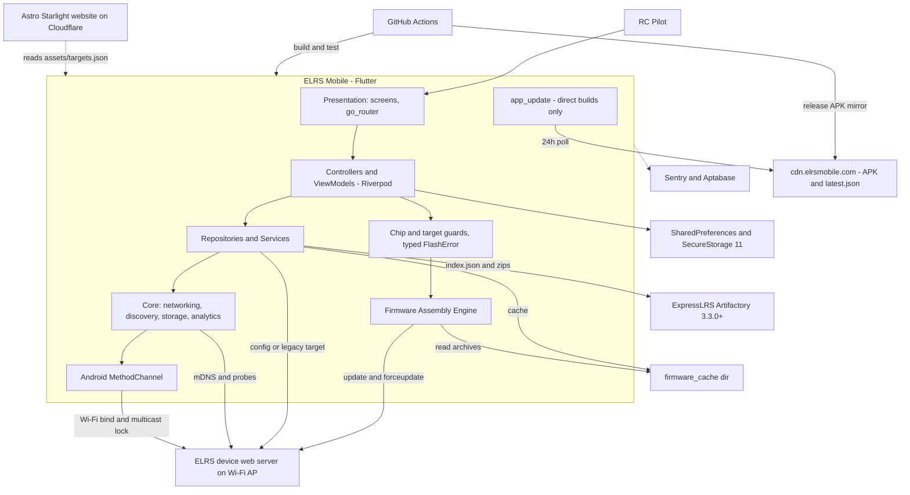

# System Architecture

**Project**: ELRS Mobile
**Architecture Pattern**: Feature-first layered (clean-architecture slices) + Riverpod reactive DI
**Last Updated**: 2026-10-27 (commit 3e8eab5, v1.0.45+111)

## High-Level Architecture

## Layers

| Layer | Purpose | Representative components |
|-------|---------|---------------------------|
| Presentation | Screens, widgets, go_router routing, theme, responsive layout | `lib/src/features/*/presentation/*`, `lib/src/router.dart`, `lib/src/app.dart`, `core/theme`, `core/presentation` |
| Application / State | Controllers and view models | `flashing_controller.dart`, `flashing/state/flashing_provider.dart`, `flashing/application/firmware_patcher.dart`, `config_view_model.dart`, `settings_controller.dart`, `app_update_service.dart` |
| Data | Repositories for Artifactory, device, CDN, local data | `flashing/data/*` (incl. `targets_provider.dart`), `app_update/data/app_update_repository.dart`, `config/services/device_config_service.dart`, `core/networking/connection_repository.dart` |
| Domain | Freezed models, sealed typed errors | `flashing/domain/*` (incl. `flash_error.dart`), `config/domain/*`, `app_update/domain/app_release.dart` |
| Firmware Assembly Engine | On-device ESP/STM32 trimming, config packing, gzip | `firmware_assembler.dart`, `stm32_firmware_patcher.dart`, `hardware_config_merger.dart`, `target_resolver.dart`, `chip_family.dart` |
| Core / Cross-cutting | Networking, discovery, storage, analytics, app info | `core/networking/*`, `core/storage/*`, `core/analytics/analytics_service.dart`, `core/app_info.dart`, `core/utils/*` |
| Native Platform | Android Wi-Fi process binding + multicast lock (iOS no-op) | `android/app/src/main/kotlin/.../MainActivity.kt` |

Dependency direction is Presentation → Application → Data / Domain / Core. Known inversions (core → feature): `discovery_service.dart` reads `isFlashingProvider`; `analytics_service.dart` reads `settingsControllerProvider.shareAnalytics`; `persistence_service.dart` imports `FlashingProfile`; `firmware_cache_service.dart` imports `HardwareConfigMerger`.

## Architectural Patterns

- **Feature-first vertical slices**: `app_update`, `config`, `configurator`, `dashboard`, `firmware_manager`, `flashing`, `settings`, `splash`, `support`; shared code in `core/`.
- **Riverpod codegen DI**: `@riverpod` / `@Riverpod(keepAlive: true)`; `ProviderContainer` built in `main.dart`, `UncontrolledProviderScope` wraps `App`.
- **Offline-first pipeline**: assembly runs on-device; internet is needed only to fill the cache.
- **Platform-channel bridging**: `MethodChannel('org.expresslrs.elrs_mobile/network')` binds the process to a no-internet Wi-Fi network and holds a multicast lock (Android only).
- **Request serialization (bulkhead)**: `SequentialRequestInterceptor` sends device requests one at a time (ESP8285 crashes under concurrency).
- **Pre-flash guards + typed outcomes**: chip-family hard block, forceable target mismatch, bind-phrase prompt; results are sealed `FlashError`s localized at the edge.
- **Confirm-by-reply flash semantics**: success only on device `status == ok`; post-upload silence is `FlashUnconfirmed`, never success.
- **Firmware-version compatibility shim**: identify/read devices back to ~3.0 via `/target` + `/mode.json`; flash only unified 3.3.0+.
- **Build-flavor gating**: `--dart-define=DISTRIBUTION=direct` compiles in the self-update check; `SENTRY_DSN` enables Sentry.
- **Codegen + l10n gate**: build_runner (freezed, json_serializable, riverpod_generator); all UI strings in ARB, enforced by `test/l10n_hygiene_test.dart`.

## Key Data Flows

### App startup
`main()` pipes `Logger` records to Sentry breadcrumbs → `ProviderContainer` → `analyticsService.init()` (Aptabase, fire-and-forget) → `runApp` → `SentryFlutter.init` if `SENTRY_DSN` (50 % sample, socket errors filtered) → post-frame `autoBindIfWiFi()` + settings load → Dashboard shows, one at a time: legal disclaimer (first launch), "Saved Settings Reset" (if flagged), update dialog (direct builds).

### Device discovery
Wi-Fi detected → `discoveryServiceProvider` (keepAlive) runs serialized `nsd` scans, paused while flashing → Android multicast lock + process bind → `ConfigViewModel` also probes `elrs_rx.local`, `elrs_tx.local`, `10.0.0.1`, manual IP → `TargetIp` → `localDio` rebuilt → heartbeat.

### Firmware download and cache
Firmware Manager → `index.json` (filtered ≥ 3.3.0) → `firmware.zip` + `hardware.zip` → `firmware_cache/<version>/`, oldest evicted. Downloads unbind from the device AP first; doing it on the hotspot is a typed error.

### Assembly and flash
Guards (device connected, chip family, bind phrase, target product) → `locating`/`unpacking` cache (download fallback) → `building` (FirmwareAssembler / STM32 patcher) → rebind Wi-Fi → `POST /update` (forced `Content-Length`, 120 s timeouts, progress 66–95 %) → `finalizing` → reply `ok` = success; `mismatch` → dialog → Force Flash re-uploads with `?force=1`, then `/forceupdate` only if still mismatched; silent drop after full upload = `FlashUnconfirmed`. Analytics: Firmware Flashed / Firmware Flash Error.

### Device configuration
Read: `/config` → V3→V4 normalization → `RuntimeConfig`; 404 → legacy `/target` + `/mode.json`. Write: only through the device's own web UI in the locked `/device_config` WebView.

### Direct-build update check
`kIsDirectDistribution` → `AppUpdateService` fetches `cdn.elrsmobile.com/latest.json` (≤ every 24 h, or Settings → Check for Updates) → dialog: Download / Later / Skip this version.

## Integration Points

| Service | Purpose | Type |
|---------|---------|------|
| ExpressLRS Artifactory | `index.json`, `firmware.zip`, `hardware.zip` (≥ 3.3.0) | HTTPS (Dio) |
| GitHub raw `targets.json` | Target list; bundled `assets/targets.json` synced by `update_targets.yml` | HTTPS + asset |
| ELRS device web server | `/`, `/hardware.json`, `/config`, legacy `/target` + `/mode.json`, `POST /update[?force=1]`, `POST /forceupdate` | Local HTTP, serialized |
| mDNS (`nsd`) | Discovery | Native |
| Android MethodChannel | Wi-Fi bind + multicast lock | Platform channel |
| cdn.elrsmobile.com (Cloudflare R2) | Direct APK (`ELRS-Mobile-latest.apk`, public link, never move) + `latest.json` | CDN |
| Sentry | Crash reporting + breadcrumbs; all release builds; not toggle-gated | SDK |
| Aptabase | Usage analytics; opt-out (`shareAnalytics` default true) | SDK |
| Google Gemini | ARB + website translation, manual dispatch only | Tooling |
| Cloudflare (website) | Builds and deploys `website/` from GitHub on push | Git-triggered deploy |

## Security & Privacy

- **Secrets**: `flutter_secure_storage` ^11 (cipher migration stage 2) for profiles, active profile, bind phrase, Wi-Fi creds. Data from ≤ 1.0.43 cannot carry over (one-time notice). `SharedPreferences` for non-sensitive prefs.
- **No auth / no backend**: unauthenticated local HTTP to an isolated AP; HTTPS to Artifactory/GitHub/CDN.
- **Safety**: chip-mismatch hard block, `FrequencyValidator` (modelId bit 7).
- **Telemetry**: Aptabase events (Firmware Downloaded/Flashed with target+version, Download/Flash Error with errorType+text, Config Webview Opened) unless Share Analytics is off; Sentry independent of the toggle. Logs carry device IPs but never phrases/passwords. Privacy policy (website `/privacy`, single source; root `PRIVACY.md` is a pointer) states this as of 2026-10-27.
- **Permissions**: Android requests no location permission; iOS `Info.plist` still declares location/camera/photo usage strings that the code does not use.

## Performance

- `targets.json` parsed on an isolate (`compute`); ~2 s probe timeouts with `CancelToken`; serialized device HTTP by design; wakelock + portrait lock during flash.

## Deployment

- **App**: Flutter SDK ^3.11, Android (primary), iOS, macOS, partial web. Version 1.0.45+111 (Play version codes run ahead of pubspec).
- **Release** (`release.yml`, `v*` tag or dispatch): direct APK (`DISTRIBUTION=direct`) → GitHub Release + `publish-apk-r2.yml` (reusable) → CDN; Play AAB; iOS IPA. `build-direct-apk.yml` for ad-hoc direct builds.
- **CI**: `ci.yml` (gen-l10n diff, analyze, test on `development` + PRs); `website.yml` (path-filtered build + `check_links.mjs`); `translate.yml` manual only.
- **Website**: Astro + Starlight, every page through Starlight with Header/Footer/Hero/ThemeProvider/ThemeSelect overrides (dark-only); single sources `src/config/{locales.json,site.ts,docs.json}`, `src/i18n/index.ts`; data-driven landing and generated hardware list. Deployed by Cloudflare from GitHub (no deploy workflow in repo).

## Related KB Links

- Component inventory: [modules.md](modules.md)
- Domain terminology: [concept_map.md](concept_map.md)
- Interaction semantics: [interaction-model.md](interaction-model.md)
- Code conventions: [patterns.md](patterns.md)
