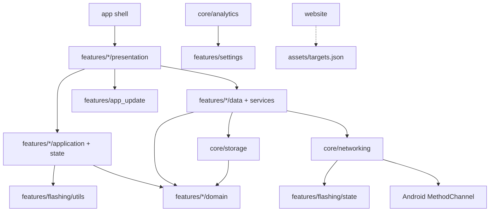

# Module & Component Breakdown

**Project**: ELRS Mobile
**Analysis Date**: 2026-10-27 (commit 3e8eab5, v1.0.45+111)
**Modules Analyzed**: ~20 (feature slices, core directories, app shell, tests, website, CI)

## Feature Modules (`lib/src/features/`)

### flashing
**Purpose**: the core feature: resolve a target, get firmware (cache first, network fallback), assemble/patch it, and flash it over Wi-Fi behind safety guards with typed outcomes. Fullest slice: `data` / `domain` / `application` / `utils` / `presentation` / `state`.
**Complexity**: High (~28 files, ~3.45k LOC).
**Key components**: `presentation/flashing_controller.dart` (~900 LOC orchestrator), `presentation/flash_error_text.dart`, `presentation/target_selectors.dart`, `domain/flash_error.dart`, `utils/chip_family.dart`, `utils/firmware_assembler.dart`, `utils/stm32_firmware_patcher.dart`, `utils/target_resolver.dart`, `utils/hardware_config_merger.dart`, `application/firmware_patcher.dart`, `data/{device,firmware,releases,targets}_repository.dart`, `data/targets_provider.dart`, `state/flashing_provider.dart`.
**Public API**: `flashingControllerProvider`, `firmwarePatcherProvider`, `targetsProvider`, `isFlashingProvider`, `deviceRepositoryProvider`, `targetsRepositoryProvider`; `FlashingScreen (/flashing)`; sealed `FlashError`.
**Contract**: anything polling the device must respect `isFlashing`.
**Since 2026-09-22**: chip-family hard block (`ChipMismatch`, daa9792); Force Flash now re-uploads with `?force=1` and only then confirms via `/forceupdate` (cf39001); success requires device `status == ok`, post-upload silence raises `FlashUnconfirmedException` → amber `FlashUnconfirmed`; typed `FlashError` hierarchy replaced string errors and is fully localized; extraction awaited inside its try (8b93f37).

### app_update (new; prior KB wrongly listed an "updates" module as removed)
**Purpose**: update check for the direct-download APK only (`kIsDirectDistribution`, set by `--dart-define=DISTRIBUTION=direct`). Fetches `cdn.elrsmobile.com/latest.json` at most every 24 h or on demand; skip version / later.
**Files**: `application/app_update_service.dart`, `data/app_update_repository.dart`, `domain/app_release.dart`, `presentation/update_dialog.dart` (~270 LOC). `CheckForUpdatesTile` lives in Settings; Dashboard triggers the startup check.

### config
**Purpose**: device connection lifecycle and config **reading**: heartbeat, discovery poller, manual IP, `RuntimeConfig` fetch with V3→V4 normalization and pre-3.1 legacy fallback, frequency validation. No native write path.
**Key components**: `presentation/config_view_model.dart`, `services/device_config_service.dart`, `domain/runtime_config_model.dart`, `domain/elrs_mappings.dart` (`domains900` only), `utils/frequency_validator.dart` (~890 LOC).

### configurator
Locked WebView (`/device_config`) hosting the device's own web UI, the only device-settings editor; emits `Config Webview Opened`; Android file-picker bridge for `.bin`/`.gz`.

### firmware_manager
Cache management UI: list/download/delete versions, storage budget. `firmware_manager_error.dart` adds a typed, localized error kind (loadFailed, onDeviceHotspot, cacheFull, serverUnreachable, downloadInterrupted, downloadFailed, deleteFailed). Reuses `ReleasesRepository` + `FirmwareCacheService` (~444 LOC).

### settings
Profiles & Network (profiles, bind phrase, home Wi-Fi, regulatory defaults), App & Storage (max cached versions, Firmware Manager, clear cache, language, Share Analytics, default **on**), Advanced & Debug (Expert Mode → Lua export, Sentry debug report), About & Legal (version, legal, Ko-fi, Check for Updates in direct builds). `settings_screen.dart` remains the largest file (~1.6k LOC); `settings_master_detail.dart` for landscape.

### dashboard
Home hub: hardware status card (scanning / connected / not found, manual IP keypad), navigation cards, and the serialized launch dialogs (disclaimer, Saved Settings Reset, update).

### splash / support
`splash_screen.dart` (3 s hand-off, "Compatible with 3.3.x/4.x"); `support_screen.dart` (Flashing Guide / FAQ / Resources, localized FAQ assets with fallback, recovery links).

## Core Modules (`lib/src/core/`)

### networking
`discovery_service.dart` (serialized `nsd` scans, paused while flashing), `connectivity_service.dart` (auto-bind/unbind), `connection_repository.dart` (`TargetIp`), `device_dio.dart` (`localDioProvider`, `SequentialRequestInterceptor`), `native_network_service.dart` (Android-only bind + multicast lock), `expected_reboot_drop.dart` (classification only, no longer "success"). ~618 LOC. All device HTTP goes through `localDioProvider`.

### storage
`persistence_service.dart`: prefs + `flutter_secure_storage` ^11 (stage-2 cipher migration), plaintext→secure migration (`security_migration_v1_done`), `secure_storage_data_lost` flag, update-check timestamps/skipped version, default profile seeding. `firmware_cache_service.dart`: archive cache, size, clear, eviction. ~468 LOC.

### analytics / app_info / theme / presentation / utils
`analytics_service.dart` (Aptabase, lazy init, honors `shareAnalytics`; core→settings dependency); `app_info.dart` (version info); `app_theme.dart` (dark-only M3); `responsive_layout.dart`; `utils/` (`binding_phrase_utils.dart`, `lua_export_utils.dart`, `validation_utils.dart`).

## Support Modules

- **App shell**: `lib/main.dart` (Logger → Sentry breadcrumbs, Sentry init when `SENTRY_DSN`), `src/app.dart`, `src/router.dart` (8 routes: `/`, `/dashboard`, `/flashing`, `/settings`, `/device_config`, `/firmware_manager`, `/legal`, `/support`).
- **Localization**: `lib/l10n/*.arb` (18 locales incl. `nb`, `app_en.arb` source, ~201 strings) → generated `AppLocalizations`; `scripts/translate.sh`, `scripts/arb_stale_check.js`, `scripts/arb_source_hashes.json`; translation runs only by manual dispatch.
- **Tests** (`test/`, 8 files): `app_update_service`, `check_for_updates_tile`, `chip_family`, `flash_error_text`, `l10n_hygiene` (fails on hard-coded UI text / unused keys), `l10n_messages`, `localization_overflow`, `secure_storage_upgrade`.
- **Website** (`website/`): Astro + Starlight; overrides in `src/components/starlight/`; landing components in `src/components/landing/` fed by `src/data/landing.ts`; `HardwareList.astro` + `src/data/hardware.ts` (from `../assets/targets.json` + `src/data/verified.json`); `src/data/usage.json` (installs); single sources `src/config/{locales.json,site.ts,docs.json}` and `src/i18n/index.ts`; scripts `build_verified.py`, `crop_store_screenshots.py`, `check_links.mjs`, `translate_astro.cjs`. Plan: `website/REDESIGN_PLAN.md`; guide: `website/README.md`.
- **CI/release** (`.github/workflows/`): `ci.yml`, `release.yml`, `build-direct-apk.yml`, `publish-apk-r2.yml`, `website.yml`, `translate.yml` (manual), `update_targets.yml`.
- **firmware_testing/**: `scripts/dart/logic_validator.dart`, `scripts/python/audit_tool.py`, golden binaries.

## Key Components Reference

| Component | File | Role |
|-----------|------|------|
| `FlashingController` | `features/flashing/presentation/flashing_controller.dart` | Guards, phases, upload, Force Flash (`?force=1` then `/forceupdate`), typed outcomes, wakelock, analytics |
| `FlashError` | `features/flashing/domain/flash_error.dart` | Sealed outcome types with analytics `code` |
| `chipFamilyOf` | `features/flashing/utils/chip_family.dart` | Chip family from target/platform name |
| `FirmwareAssembler` | `features/flashing/utils/firmware_assembler.dart` | Sole ESP builder: trim + 4 fixed blocks + gzip |
| `Stm32FirmwarePatcher` | `features/flashing/utils/stm32_firmware_patcher.dart` | UID + domain into STM32 binaries |
| `DeviceRepository` | `features/flashing/data/device_repository.dart` | `/update[?force=1]`, `/forceupdate`, reply-status parsing, `FlashUnconfirmedException` |
| `ReleasesRepository` / `FirmwareRepository` / `TargetsRepository` | `features/flashing/data/` | Versions ≥ 3.3.0, archives, targets with network→cache→asset fallback |
| `AppUpdateService` / `AppUpdateRepository` | `features/app_update/` | Direct-build update check |
| `ConfigViewModel` / `DeviceConfigService` | `features/config/` | Connection lifecycle; config read + legacy fallback |
| `DiscoveryService` | `core/networking/discovery_service.dart` | Serialized mDNS |
| `isExpectedRebootSocketDrop` | `core/networking/expected_reboot_drop.dart` | Reboot-drop classifier |
| `PersistenceService` | `core/storage/persistence_service.dart` | Prefs + secure storage + migrations |
| `FirmwareCacheService` | `core/storage/firmware_cache_service.dart` | Archive cache |
| `AnalyticsService` | `core/analytics/analytics_service.dart` | Aptabase, opt-out |

## Module Dependencies

## Module Metrics (approx., generated files excluded)

| Module | Files | LOC |
|--------|-------|-----|
| features/flashing | 28 | 3,450 |
| features/settings | 5 | 1,650 |
| features/config | 5 | 890 |
| features/dashboard | 3 | 656 |
| core/networking | 6 | 618 |
| features/support + splash | 2 | 605 |
| core/storage | 2 | 468 |
| features/firmware_manager | 3 | 444 |
| features/app_update | 4 | 270 |
| app shell | 3 | 215 |
| core/analytics + app_info + theme + presentation | 5 | 195 |
| features/configurator | 1 | 143 |
| core/utils | 3 | 91 |
| test | 8 | n/a |

## Code Quality Insights

**Well-structured**: firmware manipulation is pure/static and isolate-friendly; typed errors decouple domain from l10n and are unit-tested; one serialized device HTTP client; single shared reboot-drop predicate; website data generated from the app's own `targets.json` so the hardware list can't drift.

**Areas for improvement**:
- Core → feature inversions (networking → flashing state, analytics → settings, storage → flashing domain/utils); a neutral core flag/interfaces would remove them.
- No unit tests for repositories, `FirmwareAssembler`, or patchers (highest-risk code); `firmware_testing/` is out-of-process.
- `settings_screen.dart` (~1.6k LOC) and `flashing_controller.dart` (~900 LOC) are large.
- iOS `Info.plist` declares unused location/camera/photo usage strings.

## Related KB Links

- Layer model and flows: [architecture.md](architecture.md)
- Domain models: [concept_map.md](concept_map.md)
- Conventions: [patterns.md](patterns.md)
